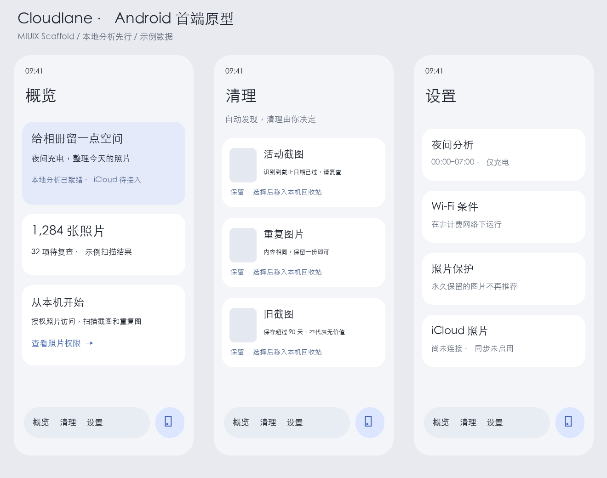

# Android 首端

[共享规则](../../spec.md) · [原型](prototype.png)
原型为示例状态，非真实相册结果。三个页面：概览、清理、设置。玻璃浮动导航与独立扫描按钮；渐进顶栏共用页面 backdrop。无权限、扫描中、出错、空候选均提供实际反馈。持久化状态由 ViewModel/SQLite 管理。
AC1–AC6 本次实现；AC7 待接入，整体保持未完成。系统删除确认由 Android 提供。
原型先行；构建与模拟器验证已执行，具体证据与未验证边界见 ../../validation.md。

## 共享基线

遵循 ../../spec.md 中 AC1–AC7。

## 原型

图为本轮 UI 编码前生成与检查的示例布局，不代表真实相册数据。

## 平台差异

Android 13+、MIUIX Scaffold、单 backdrop、系统媒体权限和回收站。

## 验收映射

AC1–AC6 为本地阶段；AC7 iCloud 保持待实现。

## 验证记录

构建命令 :app:assembleDebug :app:testDebugUnitTest。运行截图与结果写入 ../../validation.md。

图标更新：按用户补充要求改用 Deadliner 的 MIUIX-Glass Regular 源资产 CloudFill / Delete / Settings / Refresh；不再使用原型中的自绘线框图标。实际截图作为最终视觉证据。

启动器也复用 CloudFill 原始路径，仅以 inset 放入自适应图标，不另造图标风格。

配色遵循用户要求：MIUIX 原生 System 浅深色方案，关闭 Monet/壁纸取色；玻璃兼容层的所有 Material 色彩角色均由 MIUIX 映射，不使用 Material 默认色板。启动器底色采用 MIUIX tertiaryContainerVariant 浅色值。
